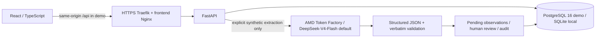

# Elo Functional Intelligence

**Elo IA Labs · AMD Developer Hackathon ACT III · Health and Wellbeing**

Elo turns synthetic occupational therapy session notes into source-linked functional observations that a human must approve, correct or reject. It addresses the documentation burden of describing participation in activities while keeping professional judgment and original evidence visible.

**Demo:** [app.eloterapia.com.br](https://app.eloterapia.com.br) — protected synthetic demonstration; access may require operator-provided authorization.

> Research prototype, synthetic data only. Not a medical device, diagnostic tool, autonomous decision-maker or signed clinical record. Never enter real patient or professional information.

## Implemented workflow

1. Register/select a synthetic organization, professional and patient; create a case/session and explicitly link the patient to the case. Session input currently supports **40 minutes**, not arbitrary durations.
2. In AMD mode, request structured candidate observations from **AMD Token Factory**, with **DeepSeek-V4-Flash** as the adapter's default model. Offline mock mode remains available and does not produce extracted observations.
3. Validate JSON/schema and require every source excerpt to be an exact continuous substring of the original notes. Invalid evidence or provider failure does not save an extraction. Verbatim matching establishes text provenance, not clinical correctness.
4. Keep candidates pending until an explicit human decision. The reviewer must be registered in the linked patient's organization. Session-text approval and observation-level review are separate.
5. Retain original wording, reviewed text/domain, reviewer references and audit events. Already reviewed observations cannot be reviewed again through the API; corrections must meaningfully change text or domain. Audit events are appended transactionally and have no application edit/delete route. This is **application-level immutability**, not cryptographic or database-administrator tamper resistance.
6. Inspect evidence in dashboards and assemble a deterministic documentation preview/consolidated draft from reviewed records. Neither step makes another model call or signs a clinical report.

Guided setup does not seed records or approve observations. Synthetic reviewer UUIDs are references, **not authenticated professional identities**.

## Architecture



- **Backend:** FastAPI/Pydantic, SQLAlchemy persistence, Alembic migrations for PostgreSQL. Local SQLite uses a durable file, not in-memory session storage.
- **Frontend:** React/TypeScript, Vite, existing CSS/SVG visualizations; source and audit drill-down.
- **Inference:** [AMD adapter](backend/app/amd_inference.py) sends chat-completion requests to the fixed Token Factory base URL. The active extraction route is in [main.py](backend/app/main.py); see [execution evidence](docs/AMD_EXECUTION_EVIDENCE.md) for the distinction between integration code and account usage.
- **Containers:** Docker API/frontend images; the [Portainer Compose contract](deploy/portainer/compose.demo.yml) uses digest-pinned GHCR artifacts, isolated PostgreSQL storage, an Alembic job before API startup, HTTPS and BasicAuth, with no API/frontend/database host ports. This describes repository configuration; live state below is operator-reported.

## Dashboards and documentation

| View | Purpose |
| --- | --- |
| Operations | Case/session counts, statuses and human-review completion; operational throughput, not child ability. |
| Functional Intelligence | Reviewed domains, descriptive session comparisons and traceable observation/source decisions. |
| Functional Progress | Case/session participation accounts, recorded duration, assistance and literal quantitative wording where present. Missing measurements remain unavailable; no progress score or improvement inference. |
| AI Governance | Approval/correction/rejection rates, audit/provenance and configured inference health. Unpersisted latency, tokens and cost remain unavailable. |

The [documentation preview](backend/app/functional_documentation.py) returns accepted observations, sources, reviewer/audit references and consolidation blockers. The [consolidated draft](frontend/src/FunctionalConsolidatedDraft.tsx) deterministically renders eligible records using that same GET response: linked synthetic patient, at least one accepted observation and no pending observations. It is not a separately persisted or signed report. [Functional architecture and longitudinal proposal](docs/FUNCTIONAL_PROGRESS_ARCHITECTURE.md) and [release-candidate evidence](docs/ACT_III_RELEASE_CANDIDATE.md) explain limits and validation.

## Family report draft (opt-in)

Session Workspace can assemble a guarded, printable synthetic family draft with explicit operator authorization and separate therapist approval/rejection. Only source/audit-verified accepted observations in the supported vocabulary may be sent as minimal text and aliases to AMD. A durable per-session reservation prevents repeat provider attempts; failures are not automatically retried. The feature is disabled by default. See [family-report safeguards and live verification](docs/FAMILY_REPORT_MVP.md) and [combined release gates](docs/COMBINED_RELEASE_CANDIDATE.md). No live inference was executed for this release candidate.

## Local development

Use Python **3.12** and Node **20**, matching CI. Run these commands from the repository root in separate terminals. They use local synthetic data and mock mode; do not point tests or development at production.

```bash
cd backend
python -m venv .venv
source .venv/bin/activate
pip install -r requirements.txt
export ELO_INFERENCE_MODE=mock
export ELO_DB_PATH="$PWD/data/elo.db"
uvicorn app.main:app --host 127.0.0.1 --port 8000
```

Windows PowerShell activation: `.venv\Scripts\Activate.ps1`; set environment variables with PowerShell syntax. SQLite is the default when `ELO_DATABASE_URL` is unset; an existing database URL takes precedence over `ELO_DB_PATH`. For an isolated PostgreSQL setup, follow [PostgreSQL cutover guidance](docs/POSTGRES_CUTOVER.md), supply `ELO_DATABASE_URL` using the `postgresql+psycopg://` driver, and run existing `python -m alembic upgrade head` before startup. Never run local migrations against production without separate authorization.

```bash
cd frontend
npm ci
npm run dev -- --host 127.0.0.1 --port 5173
```

The local frontend defaults to `http://localhost:8000`; local API docs are at `http://127.0.0.1:8000/docs`. CORS permits the two loopback port-5173 origins; it is not authentication. Deployment builds use `VITE_API_URL=/api`. Root `docker-compose.yml` is a loopback-bound **API-only local setup**, not the full protected demo deployment.

AMD mode is an explicit operator action, **not required to run tests or inspect persisted evidence**: `ELO_INFERENCE_MODE=amd`, `ELO_SYNTHETIC_ONLY_ACK=true` and a securely supplied server-side `RADEON_API_KEY`. The active adapter reads `RADEON_MODEL` (default `DeepSeek-V4-Flash`) and `RADEON_BASE_URL` (only the documented base is accepted). Root `.env.example` contains legacy `AMD_*` placeholders; they do not configure this adapter. Do not put secrets in `VITE_*` variables, commit them or send real health data to the provider.

## Tests and technical evidence

```bash
# From repository root
(cd backend && PYTHONPATH=. .venv/bin/python -m pytest -q)
(cd frontend && npm test && npm run build)
python scripts/validate-portainer.py
```

The CI runner installs backend requirements then runs `PYTHONPATH=. pytest -q`; frontend CI runs `npm ci`, `npm test`, `npm run build`. [CI workflow](.github/workflows/ci.yml) and [container validation](.github/workflows/container-validation.yml) are authoritative. Container CI builds API/frontend images **without pushing** and runs [proxy smoke](scripts/proxy-smoke.sh). Browser smoke scripts also exist, but require their specific prepared synthetic fixtures/browser/server; they are not part of the normal Vitest suite and must not target production.

The integrated baseline recorded **95 backend tests**, **42 frontend tests**, a successful production build, targeted isolated PostgreSQL validation and successful container CI. These are historical results linked in the [evidence index](docs/HACKATHON_EVIDENCE_INDEX.md), not a claim of fresh execution on every checkout. No tests, builds or inference calls are triggered by reading this README.

## Demo deployment and operational status

Use the [Portainer runbook](deploy/portainer/README.md), [API exposure guidance](docs/DEMO_API_EXPOSURE.md) and [release checklist/rollback plan](docs/ACT_III_RELEASE_CANDIDATE.md). Credentials belong in secure operator configuration. Keep port 8000 private, protect all routes, separate audience reads from trusted operator writes, and never rely on CORS or hidden buttons as authorization. The API lacks clinical identity/tenant authorization; BasicAuth is a demo boundary, not a real-patient security design. Image publication workflows are manually invoked; this documentation does not authorize publication or deployment.

For October 17, 2026, the operator reports healthy API/frontend/PostgreSQL, migration exit code 0 and HTTP 200 for health, dashboard and session-evidence routes. **Codex did not independently reproduce production checks.** The [evidence index](docs/HACKATHON_EVIDENCE_INDEX.md) lists each observation and its provenance; account counters do not establish which requests produced OT-001.

## Safety, limitations and roadmap

Only synthetic records are supported. Human review is mandatory for accepting observations as documentation evidence; there is no automatic clinical approval. Source matching does not measure extraction accuracy. No clinical benchmark, standardized assessment, diagnosis, developmental norm, treatment-effectiveness claim or longitudinal improvement percentage is established. `/health` reports configured readiness/mode; it is not proof of successful model execution, and per-request inference provenance, latency and billing are not persisted by the active adapter.

Future work includes consent/guardian transitions, scoped identity/authorization, privacy/retention design, versioned activity goals/measurements and context-aware comparability **before** real-patient or life-stage timelines; see the [longitudinal proposal](docs/FUNCTIONAL_PROGRESS_ARCHITECTURE.md). No lifetime storage is implemented by that proposal. Existing sprint specifications remain as historical design documents, not proof that every proposed feature shipped. This release candidate combines the pinned visual snapshot, documentation and guarded family-report implementations; see [combined release validation](docs/COMBINED_RELEASE_CANDIDATE.md).

Licensed under the [MIT License](LICENSE), copyright © 2026 Airton Justino O. Junior. See the historical [product specification](docs/PRODUCT_SPEC.md) and current [hackathon evidence index](docs/HACKATHON_EVIDENCE_INDEX.md).
