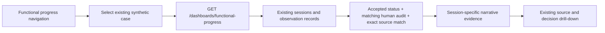

# Functional Progress — evidence MVP and longitudinal proposal

## Phase 1: implemented, read-only synthetic evidence

The existing Operations dashboard describes staff review throughput. The separate **Functional progress** navigation item describes what is recorded about participation in a selected synthetic case/session. It is an evidence browser, not a calculated measure of improvement. Operations, Functional Intelligence, Governance, review and consolidated documentation remain intact.

Base: `7e57b85`, not PR #30's branch. PR #30 (`069a459`) was inspected and remains independent: it changes review setup, shared styles and registry tests. This implementation avoids those files and adds its own component/styles and API module. No merge or dependency on that PR is required.

### Read path

`GET /dashboards/functional-progress` lists existing case IDs; `?case_id=...` returns that case's session records and eligible evidence. No case ID or expected measurement is hardcoded in application logic. The first available case is selected initially; every other returned case can be selected. Unknown cases return 404; absent cases/sessions/observations have distinct empty states. Lists show the newest 50 sessions by default (maximum 100), with the full case session count and displayed cap explicit. Source/audit reads are batched for those sessions.

Session duration comes from persisted `duration_minutes`. Dates are **record creation timestamps**, not verified activity occurrence times. The existing schema has no structured activity, goal, measurement, assistance or context table. Therefore:

- Activities and quantities remain **opaque, exact narrative strings**. An explicit `7 out of 10` is not converted into `70%`; “approximately eight minutes” and “within two minutes” are not silently converted into precise elapsed times.
- Human-reviewed wording is authoritative and separate from original text and verbatim source. Corrections retain their original reference, but a superseded original quantity is not promoted into the reviewed account.
- Task initiation, attention, motor coordination, transitions and assistance are reading topics, not clinical classifications. Grouping prefers explicit reviewed domains, with narrow English/Portuguese keyword fallback for narrative-only domains. Assistance wording is shown only where present. An activity mention alone does not establish motor performance. Topic matching can miss unfamiliar terminology; all eligible records remain in the reference list.
- A pending/rejected observation cannot establish reviewed participation. Accepted-status records without a matching decision/reviewer/text/domain/timestamp/original-text audit reference, reviewed text, or an exact case-sensitive source match are excluded and produce a visible integrity warning. This does not rewrite or repair them.
- Missing quantities are unavailable, not zero and not populated from the issue's illustrative examples. No scores, norms, independence percentages, diagnosis, treatment recommendations or cross-session outcome calculations are introduced.
- The displayed count of sessions with reviewed evidence is **documentation coverage in the shown records**, not child ability, clinical effectiveness or review approval rate.

The existing observation/decision drill-down supplies original text/domain, literal evidence and human review events. The new dashboard makes no POST requests, creates no data, calls no model and changes no review state. It inherits existing synthetic-only access/privacy limits; it is not a new authorization boundary.

### Synthetic fixture screenshots and validation

These screenshots are **local persisted synthetic fixtures**, not production screenshots or live AMD output. Fixture approvals were explicit simulated API actions. They demonstrate requested narrative examples only when stored in their own records: 3 verbal prompts, approximately 8 minutes, 7 independent attempts out of 10, and a transition within 2 minutes with verbal guidance. A second session has qualitative-only attention evidence, a third has zero observations, and another case has unrelated activity evidence.

- [Desktop evidence view](functional-progress-evidence/overview.png)
- [Qualitative-only session](functional-progress-evidence/qualitative-session.png)
- [Session without observations](functional-progress-evidence/empty-session.png)
- [Mobile evidence view](functional-progress-evidence/mobile.png)

Validation performed: complete backend suite **93 passed** (one existing Starlette/httpx TestClient deprecation warning); frontend **34 tests passed**; TypeScript/Vite production build **passed**. Backend tests cover exact wording, approximate Portuguese/English language, missing measurements, empty sessions, case isolation, source/audit failures, corrections, bounded lists and unchanged persisted records. Frontend tests cover navigation, literal accounts/provenance, missing quantities, empty states, per-session and stale cross-case isolation, retries and timeout/cancellation.

Local Chromium with a loopback same-origin `/api` proxy passed: four requested narrative examples, source/audit drill-down, empty and qualitative sessions, second-case isolation, no page overflow at 390/768/1440px, no browser runtime exceptions and no POST/extraction/AMD requests. Screenshots came from that run. Production records, PostgreSQL/VPS/Portainer, actual AMD connectivity and release images were not accessed or changed for this validation.

## Phase 2: longitudinal follow-up proposal ONLY

No tables, migration, collection of real data or lifetime storage are implemented by this proposal. The current narrative schema cannot justify comparable trends by itself. Design these concepts and obtain privacy/consent review **before** introducing real patient timelines:

| Concept | Proposed responsibility and provenance |
| --- | --- |
| Person / consent identity | Pseudonymous person reference separate from identity/contact data; explicit authorized links to episodes/cases, never matching people by names or age guesses. |
| Timeline / episode | Time-bounded purpose and care context; actual occurrence time distinguished from entry/review times, timezone and uncertainty retained. Multiple life stages do not imply indefinite retention. |
| Session and activity | Duration plus explicit activity definition/version, task/materials, environment, accessibility adaptations and participant-chosen meaning. Avoid inferring which activity a note concerns. |
| Goal / objective | Person/family/professional agreed objective, review dates and relevant context. A target is not an achieved result; no automatic milestone or diagnosis. |
| Measurement definition | Versioned operational definition, unit, sampling window, eligible trials/denominator, method and who observed it. Define “independent attempt” for a specific task before comparing it. |
| Measurement event | Explicit professional-recorded value or numerator/denominator, approximation/range/bound, missing reason, activity/context reference and source observation IDs. Preserve raw evidence; do not have a parser silently turn narrative into numeric truth. |
| Assistance | Recorded type, amount/frequency and provider within an activity; “verbal guidance” is not automatically equivalent to “minimal assistance.” Unknown is not independent. |
| Context and comparability | Versioned task difficulty, setting, tools, prompt protocol, fatigue/environmental factors if relevant/consented. Only compare events sharing a justified measurement definition and compatible context; flag changed protocols rather than drawing a trend. |
| Review / lineage | Immutable reviewed versions and correction/supersession events, reviewer identity/authorization, recorded and reviewed timestamps, source excerpt references and consent-purpose links. Historical evidence must remain distinguishable from a corrected interpretation. |
| Approved summary | Family-friendly professional-approved account of observations and uncertainties. Do not generate improvement claims, developmental norms or treatment conclusions from counts. |

### Life stages and privacy gates

- Define a lawful purpose, minimum necessary data, authorized roles and explicit consent/assent rules before collection. Separate demo fixtures from all real records; do not reuse this globally readable research API as a patient platform.
- Design guardian access with verified authority and expiration, age-appropriate assent where applicable, supported decision-making and a jurisdiction-specific transition to adult consent. Reassess sharing and obtain appropriate re-consent; do not assume one universal age threshold or indefinite guardian access.
- Enforce authenticated professional/person/guardian authorization scoped to the person and purpose. A synthetic UUID or audience BasicAuth password is not clinical identity verification or tenant authorization.
- Establish context-specific retention, review/expiry, deletion and export policies; minimize linkage identifiers and plan backup deletion/retention obligations. Resolve audit-retention conflicts under an approved policy rather than promising both indefinite immutable storage and unconditional deletion.
- Design encryption/key access, access logs, correction rights, breach response and data export before storing identifiable records. Avoid raw notes in telemetry, public screenshots, model prompts or unapproved third-party services.
- Pediatric, adult, older-adult and changing-accessibility contexts may require different goals and measurement definitions. Repeated measurements do not become comparable merely because they share a domain label. No life-stage normative score, speculative trajectory or automatic clinical judgment is proposed.

## Manual verification and release considerations

1. On a local synthetic database, use existing registry/session/observation/review APIs to create disposable records, or inspect existing **local** synthetic records. Do not run any production seed, reset or extraction. Select **Functional progress**; choose each available case and session.
2. Verify recorded duration and exact reviewed/source wording; open **Trace observation & human decision** to check IDs, reviewer and audit references. Check a session with zero observations and one with qualitative text only: quantities must not appear from another session or default examples.
3. Switch cases while a request is pending, retry a failed API request, and test a narrow screen. Revisit Operations and the existing review/documentation UI; their functions remain separate.
4. Run backend `PYTHONPATH=. .venv/bin/python -m pytest -q`; frontend `npm ci`, `npm test`, `npm run build`. New backend tests are in `test_functional_progress.py`; UI tests in `FunctionalProgress.test.tsx`. No dependency changes or database migrations are required.
5. After review, any image publication/deployment requires separate explicit authorization through the existing protected release process. API and frontend must both include the new route/component; rolling out frontend alone would produce a visible 404/retry state for the new view. Keep existing images/digests available and do not change stacks, authentication, shared networks or databases for this PR.
6. Rollback, if later authorized, restores previous approved API/frontend digests together. There are no schema/data writes to reverse. Preserve all existing sessions, observation evidence and audit events; never reset the database to remove a read-only dashboard.

The deployed OT-001 narrative quantities and completed reviews were supplied as task context, not independently verified production evidence in this PR. Screenshots and local results cannot certify live deployment behavior, clinical effectiveness, PostgreSQL compatibility at runtime or patient privacy readiness. The existing demo must remain on its approved release until separately authorized.
